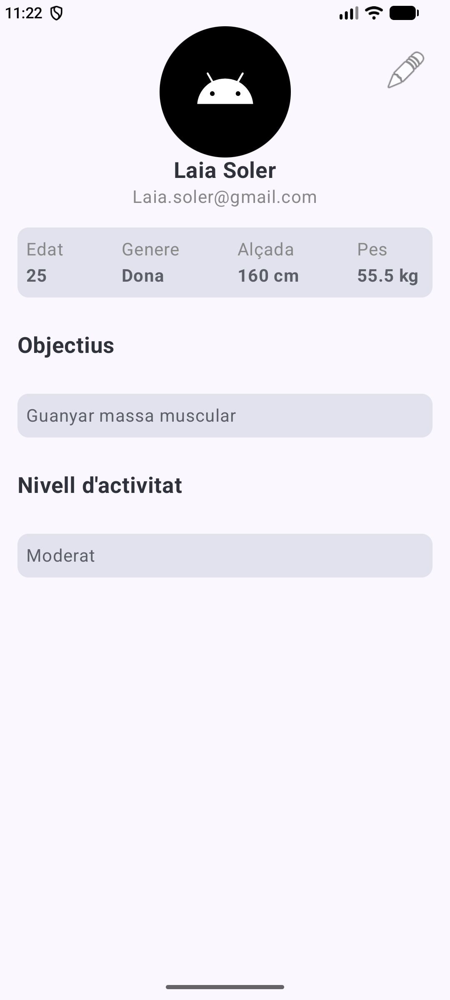
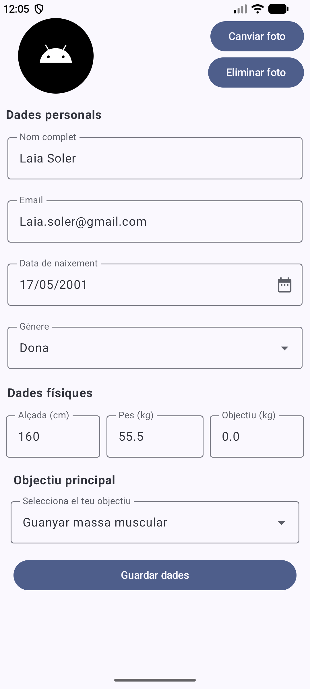

AppFitness 💪

Aplicación Android desarrollada con Kotlin y Jetpack Compose para gestionar un perfil personal y físico.

Funcionalidades

Editar datos personales.

Seleccionar fecha de nacimiento y calcular la edad.

Introducir altura y peso.

Elegir objetivos físicos.

Consultar el perfil actualizado.

Tecnologías

Kotlin

Android Studio

Jetpack Compose

### Capturas de pantalla

<table>
  <tr>
    <td align="center">
      
       
      Pantalla 1 
    </td>
    <td align="center">
      
       
      Pantalla 2 
    </td>
  </tr>
</table>
